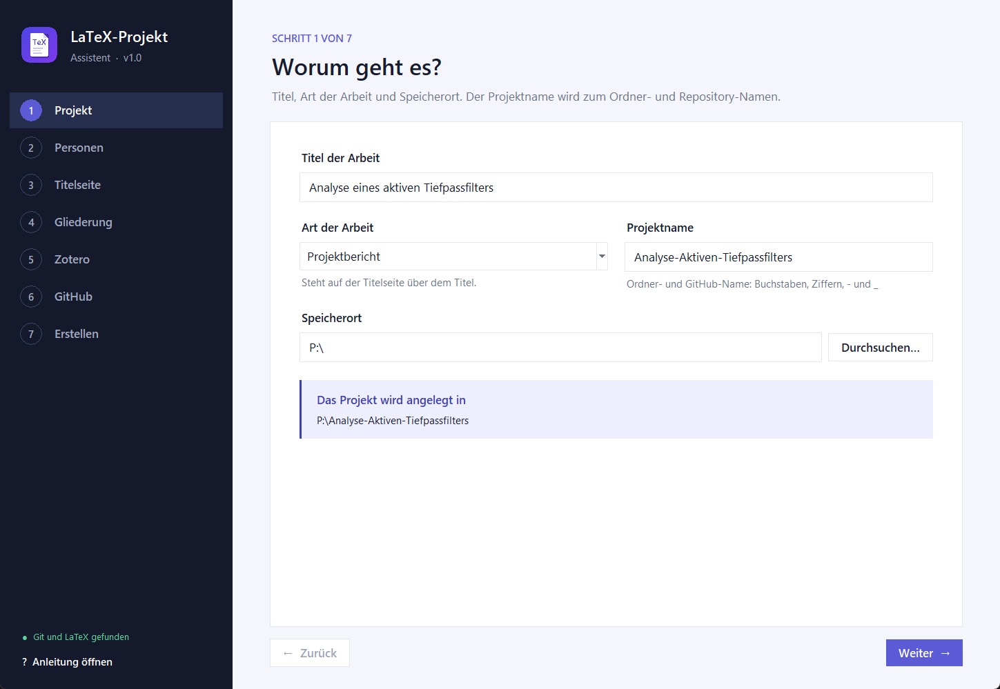
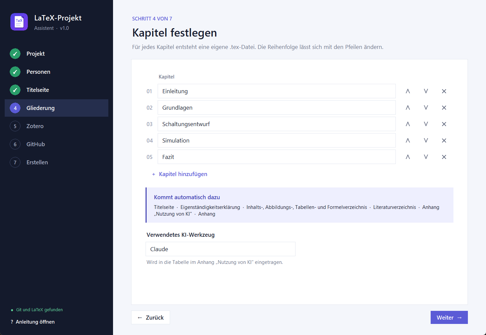
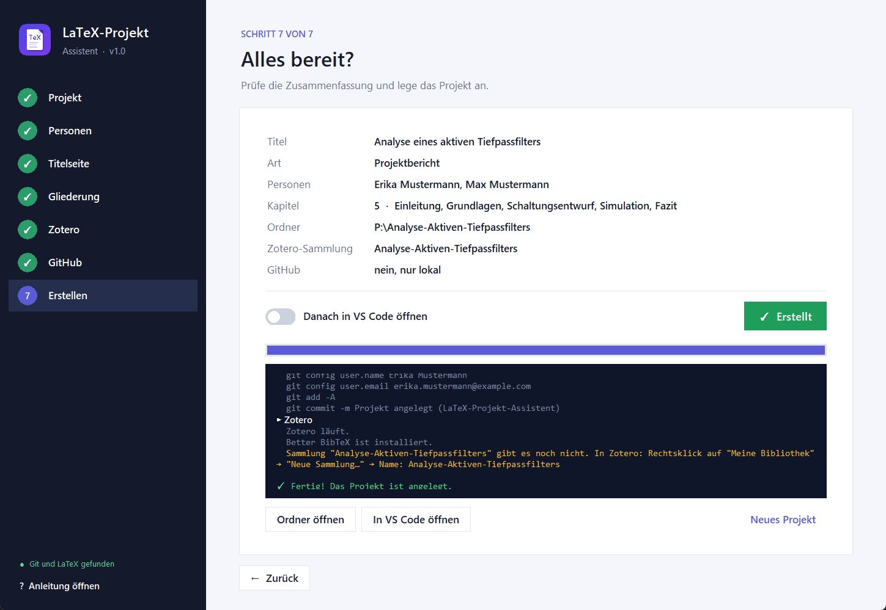

<p align="center">
  
</p>

<h1 align="center">LaTeX-Projekt-Assistent</h1>

<p align="center">
  In 7 Schritten zur fertig eingerichteten LaTeX-Ausarbeitung –<br>
  mit Zotero-Literatur, VS Code, Git und automatisch gebautem PDF auf GitHub.
</p>

<p align="center">
  <a href="#download">Download</a> ·
  <a href="docs/ANLEITUNG.md">Ausführliche Anleitung</a> ·
  <a href="docs/ANLEITUNG.md#9-probleme-lösen">Probleme lösen</a> ·
  <a href="#lizenz">Lizenz</a>
</p>



## Was macht der Assistent?

Du gibst Titel, Personen, Angaben für die Titelseite und die Kapitel ein – der Assistent legt daraus
ein komplettes, sofort baubares Projekt an:

| | |
|---|---|
| **LaTeX-Vorlage** | KOMA-Script-Bericht mit Titelseite, Eigenständigkeitserklärung (Ich-/Wir-Form), Inhalts-, Abbildungs-, Tabellen- und Formelverzeichnis, Kopfzeile mit Logo, IEEE-Literaturverzeichnis mit Quellenart, Anhang „Nutzung von KI“ |
| **Zotero** | Vor jedem Build wird die Literatur automatisch aus deiner Zotero-Sammlung geholt (Better BibTeX) |
| **VS Code** | PDF wird beim Speichern gebaut, Zitate per <kbd>Alt</kbd>+<kbd>Shift</kbd>+<kbd>Z</kbd> aus Zotero einfügen, beim Öffnen wird automatisch der neueste Stand geholt |
| **Git & GitHub** | Git-Repository mit erstem Commit, auf Wunsch privates GitHub-Repository – GitHub baut bei jedem Push das PDF und stellt es als Download bereit |

Das Ergebnis sieht so aus:

```
Mein-Projekt/
├── main.tex                 Hauptdatei (Präambel, Reihenfolge der Kapitel)
├── kapitel/                 eine .tex-Datei pro Kapitel
├── bilder/                  Abbildungen und Logo
├── literatur.bib            kommt automatisch aus Zotero
├── latexmkrc                Build-Einstellungen inkl. Zotero-Abruf
├── .vscode/                 Einstellungen für VS Code
└── .github/workflows/       automatischer PDF-Build auf GitHub
```

## Download

Such dir **eine** Variante aus:

| Variante | Für wen? | Datei |
|---|---|---|
| **Windows-Programm** | Windows 10/11 – einfach starten, kein Python nötig | [LaTeX-Projekt-Assistent-Windows.exe](https://github.com/BZ-Engineering/LaTeX-Projekt-Assistent/releases/latest/download/LaTeX-Projekt-Assistent-Windows.exe) |
| **macOS-App** | Macs mit Apple-Chip (M1 und neuer) | [LaTeX-Projekt-Assistent-macOS.zip](https://github.com/BZ-Engineering/LaTeX-Projekt-Assistent/releases/latest/download/LaTeX-Projekt-Assistent-macOS.zip) |
| **Python-Version** | Windows **und** macOS (auch Intel-Macs), wenn Python installiert ist | [LaTeX-Projekt-Assistent-Python.zip](https://github.com/BZ-Engineering/LaTeX-Projekt-Assistent/releases/latest/download/LaTeX-Projekt-Assistent-Python.zip) |

Alle Dateien liegen auch im Ordner [`downloads/`](downloads) und unter
[Releases](https://github.com/BZ-Engineering/LaTeX-Projekt-Assistent/releases). Beim ersten Start warnen Windows bzw. macOS, weil das Programm nicht
signiert ist – wie du es trotzdem öffnest, steht in der
[Anleitung, Abschnitt 3](docs/ANLEITUNG.md#3-assistent-herunterladen-und-starten).

## Schnellstart

1. **Programme installieren:** LaTeX (TeX Live bzw. MacTeX), Git, VS Code, Zotero mit Better BibTeX
   → [Schritt-für-Schritt-Anleitung](docs/ANLEITUNG.md#2-voraussetzungen-installieren)
2. **Assistent herunterladen** (siehe oben) und starten
3. **7 Schritte ausfüllen** und auf **„Projekt erstellen“** klicken
4. In Zotero eine **Sammlung mit dem Projektnamen** anlegen und Quellen hineinziehen
5. In VS Code schreiben – **Speichern baut das PDF**, **Commit & Sync** lädt hoch

Eine ausführliche Erklärung jedes Schritts mit Bildern findest du in der
**[Anleitung](docs/ANLEITUNG.md)**.

<p align="center">
  
  
</p>

## Lizenz

Der LaTeX-Projekt-Assistent steht unter der
**[PolyForm Noncommercial License 1.0.0](LICENSE.md)**.

| ✅ Erlaubt | ❌ Nicht erlaubt |
|---|---|
| Nutzung für Studium, Lehre, Forschung, private Projekte | Verkauf oder kommerzielle Vermarktung der Software |
| Nutzung durch Hochschulen und gemeinnützige Einrichtungen | Einbau in kommerzielle Produkte oder Dienstleistungen |
| Weitergeben und Verändern – mit Lizenz und Copyright-Hinweis | Weitergabe ohne Lizenztext und Copyright-Hinweis |

**Deine erzeugten Arbeiten gehören dir:** Die Dateien, die der Assistent erzeugt (Vorlage, Kapitel,
PDF), darfst du uneingeschränkt verwenden – auch für eine Praxis- oder Abschlussarbeit in einem
Unternehmen. Die Einschränkung gilt nur für die Software selbst. Maßgeblich ist der englische
Lizenztext in [LICENSE.md](LICENSE.md); diese Zusammenfassung ist keine Rechtsberatung.

Für eine kommerzielle Nutzung bitte über [BZ-Engineering](https://github.com/BZ-Engineering) anfragen.

## Für Entwickler

| Datei | Inhalt |
|---|---|
| `src/latex_projekt_assistent.pyw` | Oberfläche (tkinter, keine Zusatzpakete) |
| `src/assistent_kern.py` | Logik: Dateien erzeugen, Git, GitHub-API, Zotero-Prüfung |
| `src/vorlagen.py` | **Alle LaTeX- und Konfigurationsvorlagen** – hier Präambel, Titelseite usw. anpassen |
| `werkzeuge/pakete_bauen.py` | baut EXE, macOS-App und ZIP |
| `werkzeuge/screenshots.py` | nimmt die Bilder für die Anleitung auf |
| `.github/workflows/release.yml` | baut bei einem Tag `v*` alle Pakete auf GitHub und erstellt das Release |

Direkt aus dem Quellcode starten: `python src/latex_projekt_assistent.pyw`
(mit `--demo` werden Beispieldaten eingetragen; im Demo-Modus wird nichts gespeichert).

Neue Version veröffentlichen: Version in `src/latex_projekt_assistent.pyw` und `CHANGELOG.md`
anpassen, committen, dann `git tag v1.1.0 && git push --tags`.
