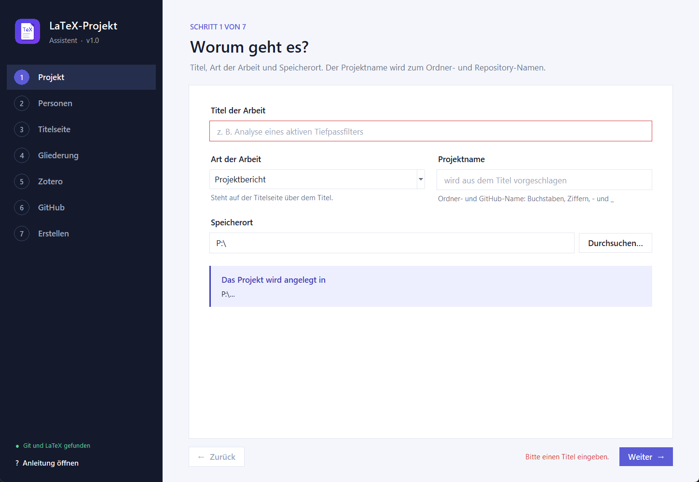
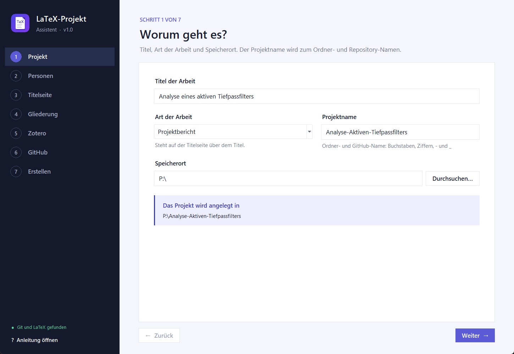
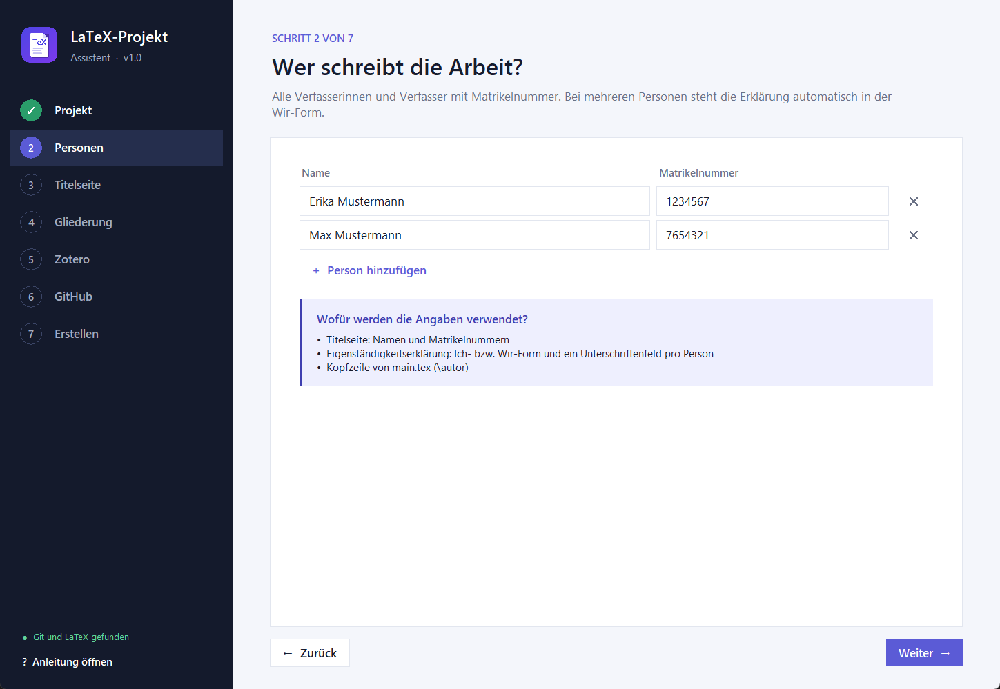
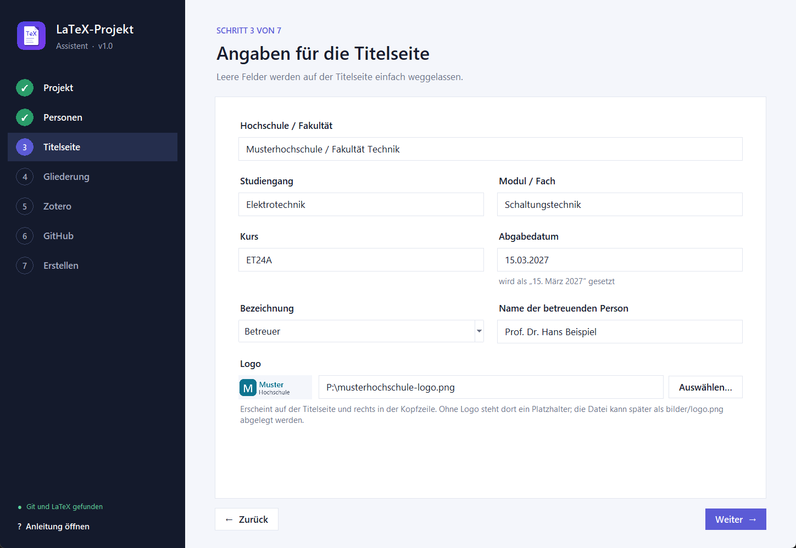
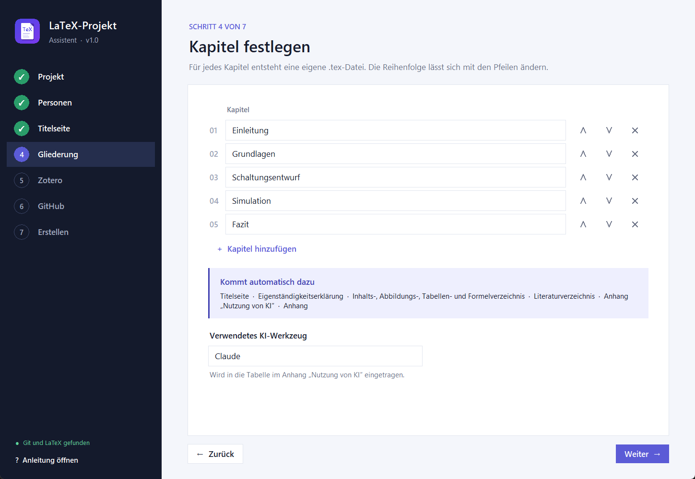
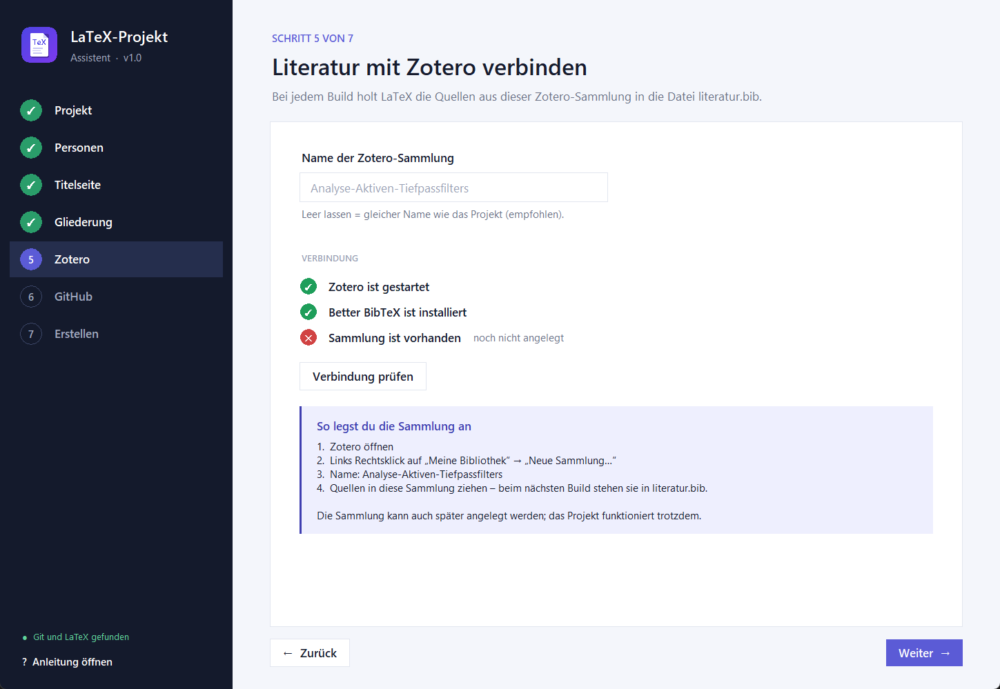
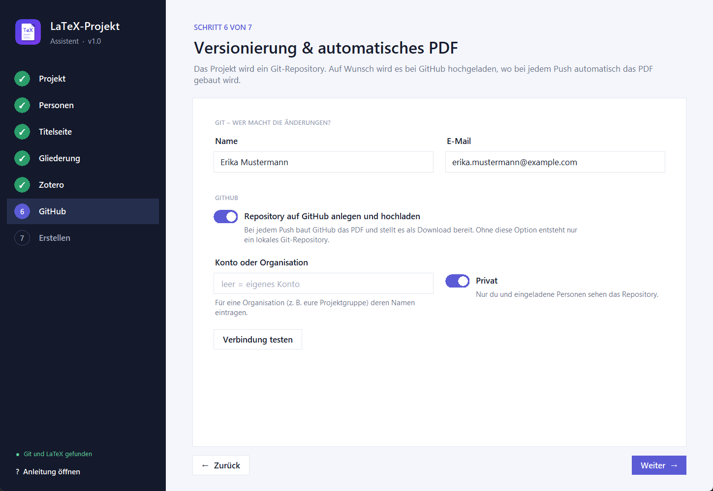
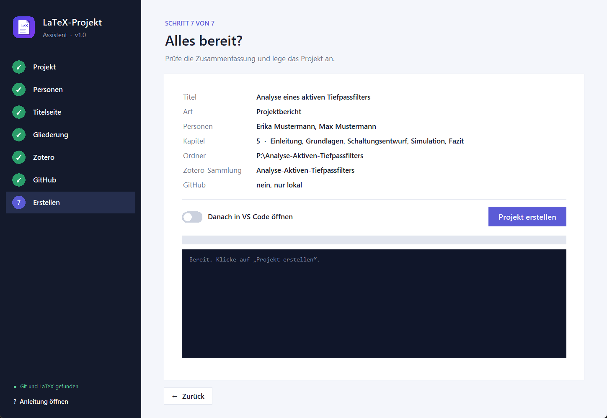
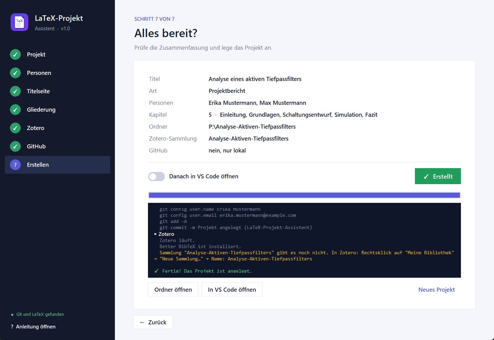

# Anleitung: LaTeX-Projekt-Assistent

Diese Anleitung führt dich vom leeren Rechner bis zum ersten fertigen PDF. Sie ist für Windows und
macOS geschrieben. Wo sich die beiden unterscheiden, steht es dabei.

**Zeitbedarf:** Einmalige Einrichtung etwa 1 Stunde (die LaTeX-Installation dauert am längsten),
danach dauert jedes neue Projekt etwa 2 Minuten.

## Inhalt

1. [Wie das Ganze zusammenspielt](#1-wie-das-ganze-zusammenspielt)
2. [Voraussetzungen installieren](#2-voraussetzungen-installieren)
3. [Assistent herunterladen und starten](#3-assistent-herunterladen-und-starten)
4. [Der Assistent Schritt für Schritt](#4-der-assistent-schritt-für-schritt)
5. [Mit dem Projekt arbeiten](#5-mit-dem-projekt-arbeiten)
6. [Literatur mit Zotero](#6-literatur-mit-zotero)
7. [GitHub: Hochladen, PDF und Zusammenarbeit](#7-github-hochladen-pdf-und-zusammenarbeit)
8. [Vorlage anpassen](#8-vorlage-anpassen)
9. [Probleme lösen](#9-probleme-lösen)
10. [Datenschutz](#10-datenschutz)

---

## 1. Wie das Ganze zusammenspielt

```
  Zotero ──(Quellen)──►  literatur.bib
                               │
  VS Code ──(Speichern)──►  LaTeX baut  ──►  main.pdf  (lokal)
     │
     └──(Commit & Sync)──►  GitHub  ──►  baut das PDF  ──►  Release „Aktuelles PDF“
```

| Programm | Aufgabe |
|---|---|
| **LaTeX** (TeX Live / MacTeX) | setzt aus den `.tex`-Dateien das PDF |
| **VS Code** mit *LaTeX Workshop* | Editor; baut beim Speichern das PDF und zeigt es an |
| **Zotero** mit *Better BibTeX* | verwaltet deine Quellen; liefert sie automatisch an LaTeX |
| **Git** | speichert jede Version deiner Arbeit |
| **GitHub** (optional) | Online-Kopie, Zusammenarbeit im Team, PDF wird automatisch gebaut |
| **LaTeX-Projekt-Assistent** | richtet all das für ein neues Projekt mit einem Klick ein |

---

## 2. Voraussetzungen installieren

Die folgenden Programme brauchst du **einmalig**. Alle sind kostenlos.

### 2.1 LaTeX

<details open>
<summary><b>Windows: TeX Live</b></summary>

1. <https://tug.org/texlive/windows.html> öffnen und **install-tl-windows.exe** herunterladen.
2. Datei starten. Falls Windows warnt: *Weitere Informationen* → *Trotzdem ausführen*.
3. *Install* wählen und die Voreinstellungen übernehmen (*scheme-full*).
4. Die Installation lädt ca. 8 GB herunter und dauert je nach Internet 30–90 Minuten.
5. Danach den Rechner **neu starten** (oder sich ab- und wieder anmelden).

**Prüfen:** Eingabeaufforderung öffnen (Windows-Taste → `cmd`) und eingeben:
```
latexmk -v
```
Es muss eine Versionsnummer erscheinen.

> **MiKTeX statt TeX Live?** Geht auch, aber dann muss zusätzlich
> [Strawberry Perl](https://strawberryperl.com) installiert sein, weil `latexmk` Perl benötigt.
> Mit TeX Live ist alles enthalten.
</details>

<details open>
<summary><b>macOS: MacTeX</b></summary>

1. <https://tug.org/mactex/> öffnen und **MacTeX.pkg** herunterladen (ca. 6 GB).
2. Paket öffnen und durchklicken.
3. Terminal öffnen (<kbd>⌘</kbd>+<kbd>Leertaste</kbd> → „Terminal“) und prüfen:
   ```
   latexmk -v
   ```
</details>

### 2.2 Git

<details open>
<summary><b>Windows: Git for Windows</b></summary>

1. <https://git-scm.com/download/win> → *64-bit Git for Windows Setup* herunterladen.
2. Installieren und **alle Voreinstellungen übernehmen**. Darin enthalten ist der
   *Git Credential Manager*, über den sich der Assistent später bei GitHub anmeldet.
</details>

<details open>
<summary><b>macOS</b></summary>

Im Terminal eingeben:
```
xcode-select --install
```
und im erscheinenden Fenster *Installieren* klicken. Damit ist Git vorhanden.
</details>

### 2.3 Visual Studio Code

1. <https://code.visualstudio.com> → herunterladen und installieren.
   - **Windows:** Im Installer den Haken bei *„Zu PATH hinzufügen“* gesetzt lassen.
   - **macOS:** App in den Programme-Ordner ziehen, VS Code öffnen,
     <kbd>⌘</kbd>+<kbd>⇧</kbd>+<kbd>P</kbd> → `Shell Command: Install 'code' command in PATH` ausführen.
2. Die nötigen Erweiterungen musst du nicht selbst suchen: Wenn du das erste Projekt in VS Code
   öffnest, schlägt VS Code sie unten rechts vor → **„Installieren“** klicken. Es sind:
   - *LaTeX Workshop* (baut und zeigt das PDF)
   - *Citation Picker for Zotero* (Zitate einfügen)
   - *Code Spell Checker – German* (Rechtschreibprüfung, optional)
   - *GitHub Actions* (Status des PDF-Builds, optional)

### 2.4 Zotero und Better BibTeX

1. <https://www.zotero.org/download/> → **Zotero 7** installieren.
2. Better BibTeX herunterladen: <https://github.com/retorquere/zotero-better-bibtex/releases/latest>
   → unter *Assets* die Datei **`zotero-better-bibtex-….xpi`** mit **Rechtsklick → „Link speichern unter…“**
   herunterladen (ein normaler Klick versucht, sie in Firefox zu installieren).
3. Zotero öffnen → **Werkzeuge → Plugins** → Zahnrad oben rechts → **„Plugin aus Datei installieren…“**
   → die `.xpi`-Datei auswählen → Zotero neu starten.
4. Empfohlen: die Browser-Erweiterung *Zotero Connector* von derselben Download-Seite, um Quellen
   mit einem Klick aus dem Browser zu speichern.

### 2.5 GitHub (optional, aber empfohlen)

1. Auf <https://github.com/signup> ein kostenloses Konto anlegen.
   Studierende bekommen über das [GitHub Student Developer Pack](https://education.github.com/pack)
   zusätzliche Vorteile.
2. Die **Anmeldung** passiert später automatisch im Assistenten:
   - **Windows:** Beim ersten Mal öffnet sich ein Fenster *„Connect to GitHub“* →
     **„Sign in with your browser“** → im Browser bestätigen. Danach merkt sich Windows die Anmeldung.
   - **macOS:** Hier gibt es dieses Fenster nicht. Einmalig die GitHub-Kommandozeile installieren und anmelden:
     ```
     /bin/bash -c "$(curl -fsSL https://raw.githubusercontent.com/Homebrew/install/HEAD/install.sh)"
     brew install gh
     gh auth login
     ```
     Bei den Fragen jeweils die Voreinstellung mit <kbd>Enter</kbd> bestätigen
     (*GitHub.com → HTTPS → Yes → Login with a web browser*).

### 2.6 Python (nur für die Python-Version)

Die **Windows-EXE** und die **macOS-App** brauchen kein Python. Nur wer die Python-Version nutzt:

- <https://www.python.org/downloads/> → aktuelle Version installieren.
- **Windows:** Im ersten Fenster des Installers unbedingt **„Add python.exe to PATH“** anhaken.
- **macOS:** Den Installer von python.org verwenden (er enthält *tkinter* für die Oberfläche).

---

## 3. Assistent herunterladen und starten

Lade **eine** Variante von der [Startseite](../README.md#download) herunter.

### Windows-Programm (`.exe`)

1. `LaTeX-Projekt-Assistent-Windows.exe` an einen beliebigen Ort legen, z. B. auf den Desktop.
2. Doppelklick. Beim ersten Mal erscheint *„Der Computer wurde durch Windows geschützt“*,
   weil das Programm nicht kostenpflichtig signiert ist → **„Weitere Informationen“** →
   **„Trotzdem ausführen“**.
3. Der Start dauert beim ersten Mal ein paar Sekunden.

### macOS-App

1. `LaTeX-Projekt-Assistent-macOS.zip` doppelklicken → die App in den Programme-Ordner ziehen.
2. Beim ersten Mal **Rechtsklick (bzw. <kbd>ctrl</kbd>-Klick) auf die App → „Öffnen“ → „Öffnen“**.
3. Falls macOS trotzdem blockiert: **Systemeinstellungen → Datenschutz & Sicherheit** →
   ganz unten bei *„LaTeX-Projekt-Assistent wurde blockiert“* auf **„Dennoch öffnen“** klicken.

Die App ist für Macs mit Apple-Chip (M1 oder neuer) gebaut. Auf älteren Intel-Macs bitte die
Python-Version nutzen.

### Python-Version (Windows und macOS)

1. ZIP entpacken.
2. **Windows:** Doppelklick auf `Start-Windows.bat`.
   **macOS:** Beim ersten Mal Rechtsklick auf `Start-macOS.command` → *Öffnen*, danach reicht ein Doppelklick.

Unten links in der Seitenleiste zeigt der Assistent an, ob **Git und LaTeX** gefunden wurden.
Steht dort eine gelbe Warnung, fehlt eines der Programme aus Abschnitt 2 – oder der Rechner
wurde nach der Installation noch nicht neu gestartet.

---

## 4. Der Assistent Schritt für Schritt

Links siehst du die sieben Schritte. Mit **Weiter** geht es vorwärts; fehlt eine Pflichtangabe,
wird das Feld rot markiert und unten erscheint ein Hinweis:



Bereits besuchte Schritte bekommen einen grünen Haken und lassen sich jederzeit anklicken, um
etwas zu ändern. Personen, Hochschule, Kurs, Logo, Kapitel und die GitHub-Einstellungen merkt sich
der Assistent für das nächste Projekt.

### Schritt 1 – Projekt



| Feld | Erklärung |
|---|---|
| **Titel der Arbeit** | erscheint auf der Titelseite und in der Eigenständigkeitserklärung. Sonderzeichen wie `&` oder `%` werden automatisch richtig gesetzt. |
| **Art der Arbeit** | z. B. Projektbericht, Studienarbeit, Bachelorarbeit – steht über dem Titel. Du kannst auch etwas Eigenes eintippen. |
| **Projektname** | wird aus dem Titel vorgeschlagen (Füllwörter fallen weg). Er ist der Name des Ordners, des GitHub-Repositorys und der Zotero-Sammlung. Erlaubt sind nur Buchstaben ohne Umlaute, Ziffern, `-` und `_`. |
| **Speicherort** | Ordner, in dem der Projektordner angelegt wird, z. B. *Dokumente*. |

> **Tipp:** Lege Projekte **nicht** in einen OneDrive-, iCloud- oder Dropbox-Ordner. Die
> Synchronisierung verträgt sich schlecht mit Git und den vielen Hilfsdateien von LaTeX.
> Die Sicherung übernimmt GitHub.

### Schritt 2 – Personen



Eine Zeile pro Person, mit **„+ Person hinzufügen“** kommen weitere dazu, mit **✕** wird eine entfernt.
Die Matrikelnummer ist optional.

- **Eine Person:** Die Erklärung steht in der Ich-Form, auf der Titelseite steht „Matrikelnummer“.
- **Mehrere Personen:** Die Erklärung steht in der Wir-Form, jede Person bekommt ein eigenes
  Unterschriftenfeld, auf der Titelseite steht z. B. „1234567 (E. Mustermann), 7654321 (M. Mustermann)“.

### Schritt 3 – Titelseite



Alle Felder sind optional – was leer bleibt, erscheint einfach nicht auf der Titelseite.

- **Abgabedatum** als `TT.MM.JJJJ` eingeben; es wird als „15. März 2027“ gesetzt.
- **Bezeichnung:** Dozent, Betreuerin, Gutachter usw. – oder ein eigener Begriff.
- **Logo:** PNG, JPG oder PDF. Es erscheint groß auf der Titelseite und klein rechts in der Kopfzeile
  jeder Seite. Ohne Logo steht dort ein Platzhalterkasten; du kannst die Datei später als
  `bilder/logo.png` in den Projektordner legen.

### Schritt 4 – Gliederung



Für jedes Kapitel entsteht eine eigene Datei, z. B. `kapitel/02_einleitung.tex`. Mit **∧** und **∨**
änderst du die Reihenfolge. Titelseite, Erklärung, Verzeichnisse, Literaturverzeichnis und Anhang
kommen automatisch dazu.

Das **KI-Werkzeug** wird in die Tabelle im Anhang *„Anmerkung zur Nutzung von Künstlicher Intelligenz“*
eingetragen. Viele Hochschulen verlangen diese Angabe – die Tabelle kannst du später um konkrete
Einsatzzwecke ergänzen.

### Schritt 5 – Zotero



Der Assistent prüft drei Dinge:

| Prüfung | Wenn rot … |
|---|---|
| **Zotero ist gestartet** | Zotero öffnen, dann *„Verbindung prüfen“* |
| **Better BibTeX ist installiert** | Plugin installieren, siehe [2.4](#24-zotero-und-better-bibtex) |
| **Sammlung ist vorhanden** | In Zotero links Rechtsklick auf *Meine Bibliothek* → *Neue Sammlung…* → genau den angezeigten Namen eingeben |

Ein rotes Kreuz bei der Sammlung ist **kein Hindernis** – du kannst sie auch nach dem Erstellen
anlegen. Bis dahin bleibt das Literaturverzeichnis einfach leer.

### Schritt 6 – GitHub



- **Name und E-Mail** stehen in jeder gespeicherten Version („Commit“). Am besten dieselbe E-Mail
  wie bei GitHub verwenden, dann werden die Änderungen deinem Profil zugeordnet.
- **Repository auf GitHub anlegen:** Ausschalten, wenn du nur lokal arbeiten willst.
- **Konto oder Organisation:** leer lassen = dein eigenes Konto. Für eine Gruppe könnt ihr auf GitHub
  eine (kostenlose) Organisation anlegen und deren Namen eintragen.
- **Privat:** Nur du und eingeladene Personen sehen das Repository und das PDF.
- **Verbindung testen:** prüft die Anmeldung. Beim ersten Mal öffnet sich unter Windows das
  Anmeldefenster, siehe [2.5](#25-github-optional-aber-empfohlen).

### Schritt 7 – Erstellen



Prüfe die Zusammenfassung und klicke auf **„Projekt erstellen“**. Im dunklen Fenster siehst du,
was passiert:

1. Dateien anlegen
2. Git-Repository anlegen und ersten Stand speichern
3. *(mit GitHub)* Repository anlegen und hochladen
4. Zotero-Sammlung prüfen



Danach kannst du den Ordner oder VS Code direkt öffnen. Mit GitHub erscheint zusätzlich
**„Repository auf GitHub“**. Über **„Neues Projekt“** geht es mit den gemerkten Angaben von vorn los.

---

## 5. Mit dem Projekt arbeiten

### 5.1 Öffnen

VS Code öffnet sich automatisch (falls eingeschaltet). Sonst: VS Code → *Datei → Ordner öffnen…* →
Projektordner. Beim ersten Mal:

- *„Vertrauen Sie den Autoren …?“* → **„Ja, ich vertraue den Autoren“**
- unten rechts *„Empfohlene Erweiterungen installieren?“* → **„Installieren“**

### 5.2 Schreiben und PDF bauen

- Kapiteltexte schreibst du in `kapitel/…tex`. Unter jeder Kapitelüberschrift steht ein Kommentar
  (`% Text zu …`), den du durch deinen Text ersetzt.
- **Speichern (<kbd>Strg</kbd>+<kbd>S</kbd> bzw. <kbd>⌘</kbd>+<kbd>S</kbd>) baut das PDF.**
  Der erste Durchlauf dauert etwas länger.
- PDF anzeigen: In `main.tex` oben rechts auf das Symbol mit der Lupe (*View LaTeX PDF*) klicken.
  Es öffnet sich als eigener Tab und aktualisiert sich bei jedem Speichern.
- Fehler stehen unten im Reiter *Probleme*. Ein Klick springt zur Stelle.

### 5.3 Nützliche Befehle in der Vorlage

| Befehl | Wirkung |
|---|---|
| `\bild[0.6\textwidth]{schaltung}` | setzt `bilder/schaltung.png` (oder .jpg/.pdf); fehlt die Datei, erscheint ein Platzhalter statt eines Fehlers |
| `\formel{Ohmsches Gesetz}` | innerhalb einer `equation`-Umgebung: trägt die Formel ins Formelverzeichnis ein |
| `\SI{4.7}{\kilo\ohm}` | Zahl mit Einheit, deutsches Komma automatisch |
| `\cite{schluessel}` | Quelle zitieren (siehe 5.4) |
| `\arbeitstitel`, `\autor` | Titel bzw. Namen, wie im Assistenten eingegeben |

Beispiel für eine Abbildung:

```latex
\begin{figure}[htbp]
  \centering
  \bild[0.7\textwidth]{messaufbau}
  \caption{Messaufbau im Labor}
  \label{fig:messaufbau}
\end{figure}
```

Weitere Kapitel: Datei in `kapitel/` anlegen und in `main.tex` eine Zeile `\input{kapitel/…}` ergänzen.

### 5.4 Zitieren

1. Zotero muss laufen.
2. In VS Code an die gewünschte Stelle klicken und
   **<kbd>Alt</kbd>+<kbd>Shift</kbd>+<kbd>Z</kbd>** (macOS: <kbd>⌥</kbd>+<kbd>⇧</kbd>+<kbd>Z</kbd>) drücken.
3. Im Zotero-Suchfenster die Quelle suchen, mit <kbd>Enter</kbd> auswählen.
   Es wird z. B. `\cite{mustermann2024}` eingefügt.
4. Speichern: Die Literaturliste wird automatisch aus Zotero geholt, das Literaturverzeichnis aktualisiert.

### 5.5 Versionen speichern und hochladen

In VS Code links auf das **Quellcodeverwaltungs-Symbol** (Verzweigung, <kbd>Strg</kbd>+<kbd>Shift</kbd>+<kbd>G</kbd>):

1. Oben eine kurze Nachricht eingeben, z. B. *„Kapitel Grundlagen ergänzt“*.
2. Auf **„Commit“** klicken. Die Vorlage ist so eingestellt, dass danach automatisch
   **synchronisiert** (hochgeladen und heruntergeladen) wird.
3. Beim Öffnen des Projekts holt VS Code automatisch den neuesten Stand von GitHub – wichtig,
   wenn ihr zu mehreren arbeitet.

Faustregel: **Mindestens einmal pro Arbeitssitzung committen.** Jeder Commit ist eine Sicherung,
zu der du jederzeit zurückkehren kannst.

---

## 6. Literatur mit Zotero

- **Quellen sammeln:** Mit dem *Zotero Connector* im Browser auf das Zotero-Symbol klicken, während
  die Quelle angezeigt wird. Bücher lassen sich in Zotero über den Zauberstab per ISBN, Artikel per DOI
  hinzufügen.
- **In die Projekt-Sammlung ziehen:** Nur Quellen in der Sammlung mit dem Projektnamen landen in
  `literatur.bib`. Eine Quelle kann in mehreren Sammlungen gleichzeitig sein.
- **Quellenart:** Im Literaturverzeichnis steht vor jedem Eintrag die Art in eckigen Klammern,
  z. B. *[Onlinequelle]*, *[Buchquelle]*, *[Norm]*. Bei *Bericht* kannst du in Zotero das Feld
  **„Typ“** ausfüllen (z. B. *Datenblatt*), dann steht dieses Wort dort.
- **Online-Quellen:** In Zotero das Feld *„Abgerufen am“* ausfüllen, damit das Abrufdatum erscheint.
- **Ohne Zotero / unterwegs:** Läuft Zotero nicht, wird die zuletzt geholte `literatur.bib` verwendet.
  Auf GitHub ist das genauso – deshalb vor dem Hochladen einmal mit laufendem Zotero speichern.

---

## 7. GitHub: Hochladen, PDF und Zusammenarbeit

### Automatisches PDF

Bei jedem Hochladen baut GitHub das PDF neu (Dauer ca. 2–3 Minuten):

- **Repository → Reiter „Actions“:** grüner Haken = erfolgreich, rotes Kreuz = Fehler.
  Bei einem Fehler im Lauf unten das Artefakt *LaTeX-Log* herunterladen.
- **Repository → „Releases“ → „Aktuelles PDF“:** dort liegt immer das neueste PDF.
  Der Link steht auch in der `README.md` des Projekts und bleibt immer gleich – ideal zum Teilen mit
  Betreuenden, die Zugriff auf das Repository haben.

### Zu mehreren arbeiten

1. Repository auf GitHub → **Settings → Collaborators → Add people** → GitHub-Namen eintragen.
2. Die eingeladene Person nimmt die Einladung an (kommt per Mail) und öffnet in VS Code:
   <kbd>F1</kbd> → `Git: Clone` → *Clone from GitHub* → Repository auswählen.
3. Die eingeladene Person braucht für Zotero-Zitate eine eigene Zotero-Sammlung mit demselben Namen –
   oder ihr nutzt in Zotero eine **Gruppenbibliothek** (dann in `latexmkrc` die URL anpassen, siehe
   [Better-BibTeX-Doku](https://retorque.re/zotero-better-bibtex/exporting/pull/)).
4. Tipp: Teilt die Arbeit nach Kapiteln auf. Wenn zwei Personen gleichzeitig dieselbe Zeile ändern,
   fragt VS Code beim Synchronisieren nach, welche Fassung gelten soll.

---

## 8. Vorlage anpassen

### Im einzelnen Projekt

Alles steht in `main.tex` und ist kommentiert, z. B. Seitenränder (`geometry`), Zeilenabstand
(`\onehalfspacing`), Zitierstil (`style=ieee`) und die Abstände der Überschriften.

### Für alle künftigen Projekte

Mit der **Python-Version** kannst du die Vorlage selbst ändern: In `vorlagen.py` stehen alle Dateien
als Text, z. B. `MAIN_TEX` (Präambel), `TITELSEITE_TEX`, `ERKLAERUNG_…`. Platzhalter in der Form
`<<TITEL>>` werden vom Assistenten ersetzt.

---

## 9. Probleme lösen

<details>
<summary><b>Unten links steht „Nicht gefunden: Git“ oder „latexmk“</b></summary>

Das Programm ist nicht installiert oder der Rechner wurde danach nicht neu gestartet. Siehe
[Abschnitt 2](#2-voraussetzungen-installieren). Unter macOS: Bei MacTeX liegt `latexmk` in
`/Library/TeX/texbin` – der Assistent sucht dort automatisch.
</details>

<details>
<summary><b>„Kein GitHub-Login gefunden“</b></summary>

- **Windows:** Git for Windows mit den Standardoptionen (neu) installieren; der Git Credential Manager
  ist dann enthalten. Danach im Assistenten *„Verbindung testen“*.
- **macOS:** Im Terminal `gh auth login` ausführen (siehe [2.5](#25-github-optional-aber-empfohlen)).
</details>

<details>
<summary><b>„GitHub 422: name already exists on this account“</b></summary>

Ein Repository mit diesem Namen gibt es schon. Einen anderen Projektnamen wählen. Der lokale Ordner
wurde bereits angelegt – ihn vorher löschen oder einen anderen Namen nehmen.
</details>

<details>
<summary><b>„GitHub 403/404“ bei einer Organisation</b></summary>

Du hast in der Organisation keine Rechte, Repositorys anzulegen, oder der Name ist falsch geschrieben.
Organisation auf GitHub → *Settings → Member privileges* prüfen bzw. eine Person mit Owner-Rechten fragen.
</details>

<details>
<summary><b>Literaturverzeichnis bleibt leer</b></summary>

1. Läuft Zotero? Ist Better BibTeX installiert? (Assistent → Schritt 5 → *Verbindung prüfen*)
2. Heißt die Sammlung **genau** wie in `latexmkrc` angegeben (Groß-/Kleinschreibung)?
3. Wird die Quelle im Text mit `\cite{…}` zitiert? Nur zitierte Quellen erscheinen im Verzeichnis.
4. In der Ausgabe von LaTeX Workshop (unten *Ausgabe* → *LaTeX Compiler*) steht
   *„Zotero: literatur.bib aktualisiert“* oder der Grund, warum nicht.
</details>

<details>
<summary><b>Das PDF auf GitHub wird nicht gebaut (rotes Kreuz)</b></summary>

Repository → *Actions* → fehlgeschlagenen Lauf öffnen → unten Artefakt *LaTeX-Log* herunterladen und
in `main.log` nach Zeilen mit `!` suchen. Meist ist es ein Tippfehler, der lokal auch auftritt.
Häufiger Sonderfall: ein Bild, das lokal existiert, aber nicht committet wurde.
</details>

<details>
<summary><b>Windows: „Der Computer wurde durch Windows geschützt“ / Virenscanner meldet die EXE</b></summary>

Das Programm ist nicht kostenpflichtig signiert, deshalb warnt Windows. *Weitere Informationen →
Trotzdem ausführen*. Manche Virenscanner melden mit PyInstaller gebaute Programme fälschlich. Wer
sichergehen will, nutzt die Python-Version – dort ist der gesamte Quelltext lesbar.
</details>

<details>
<summary><b>macOS: „App ist beschädigt und kann nicht geöffnet werden“</b></summary>

Das ist die Quarantäne-Markierung für heruntergeladene, nicht signierte Apps. Im Terminal:
```
xattr -dr com.apple.quarantine "/Applications/LaTeX-Projekt-Assistent.app"
```
</details>

<details>
<summary><b>Das Fenster ist sehr klein oder sehr groß</b></summary>

Der Assistent passt sich der Windows-Skalierung an. Bei sehr kleinen Bildschirmen lässt sich das
Fenster verkleinern; die Inhalte werden dann scrollbar.
</details>

---

## 10. Datenschutz

- Der Assistent speichert deine zuletzt verwendeten Angaben nur lokal:
  - Windows: `%APPDATA%\latex-projekt-assistent.json`
  - macOS: `~/Library/Application Support/latex-projekt-assistent.json`
- Verbindungen nach außen gibt es nur zu **GitHub** (wenn du ein Repository anlegst oder die
  Verbindung testest) und lokal zu **Zotero** auf deinem eigenen Rechner (`127.0.0.1`).
- Dein GitHub-Zugang wird nicht gespeichert, sondern bei Bedarf vom Git Credential Manager bzw. von
  `gh` abgefragt.
